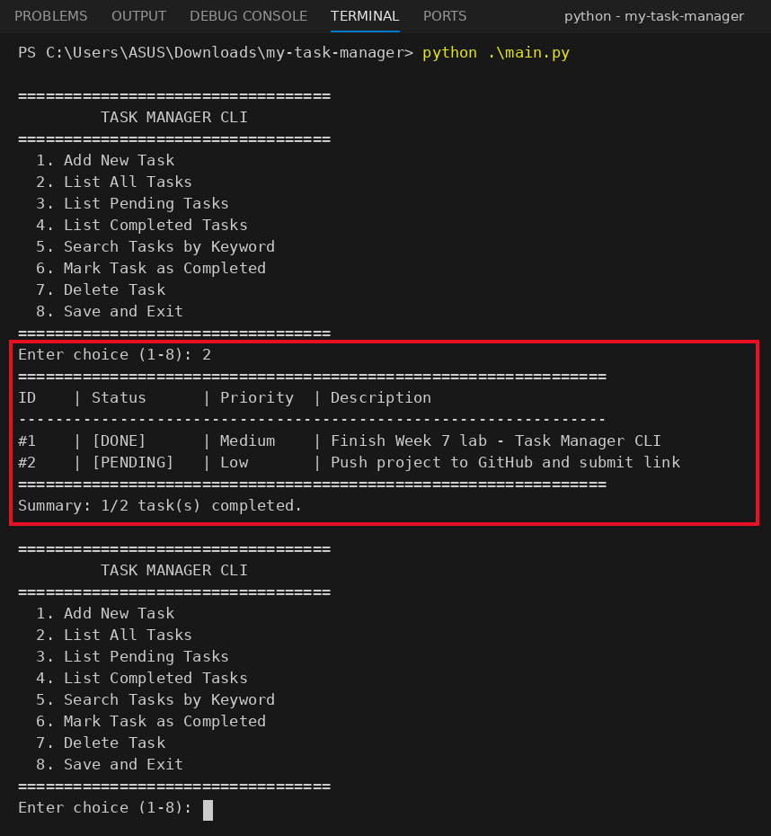

# Week 7: Building a Simple CLI Application, Error Handling & Project Structure

ผู้จัดทำ: เมธาวี สิทธิชัยเนตร, รหัสนักศึกษา 663380372-6

**My Simple Task Manager CLI** เป็นโปรแกรม command line สำหรับจัดการงาน
- เพิ่ม ดู ค้นหา ทำเครื่องหมายว่าเสร็จ และลบงานได้
- บันทึกข้อมูลลง `data/tasks.json` อัตโนมัติ เปิดโปรแกรมใหม่ข้อมูลยังอยู่

## 📸 Screenshot: เลือก `2. List All Tasks`
มี 1 งานที่ **[DONE]** และ 1 งานที่ **[PENDING]**



## Features
| เมนู | ความสามารถ |
|---|---|
| 1. Add New Task | เพิ่มงาน (description + priority High/Medium/Low) แล้วได้ ID อัตโนมัติ |
| 2. List All Tasks | แสดงตาราง ID / Status / Priority / Description พร้อม Summary |
| 3. List Pending Tasks | เฉพาะงานที่ยังไม่เสร็จ |
| 4. List Completed Tasks | เฉพาะงานที่เสร็จแล้ว |
| 5. Search Tasks by Keyword | ค้นหาจากคำใน description (ไม่สนตัวพิมพ์เล็ก-ใหญ่) |
| 6. Mark Task as Completed | ทำเครื่องหมายว่าเสร็จด้วย ID |
| 7. Delete Task | ลบงานด้วย ID |
| 8. Save and Exit | บันทึกลง `data/tasks.json` แล้วออก |

## Error Handling (Defensive Input)
- ใส่ ID ที่ไม่ใช่ตัวเลข (เช่น `abc`) จะจับ `ValueError` แล้วแสดง "Invalid input. Please enter a number for Task ID."
- เลือกเมนูนอก 1-8 หรือ description/keyword ว่าง จะแจ้งเตือนแล้วกลับไปที่เมนู
- ID ที่ไม่มีอยู่จะแสดง "Error: Task with ID ... not found."
- `tasks.json` ว่างหรือเสีย จะจับ `JSONDecodeError` แล้วเริ่มด้วยรายการว่าง
- กด Ctrl+C จะบันทึกงานก่อนออก ข้อมูลไม่หาย

## How to Run
```bash
git clone https://github.com/punchyayaho/<repo-name>.git
cd <repo-name>
python main.py
```
ใช้แค่ Python standard library (`json`, `os`, `sys`) จึงไม่ต้องติดตั้งอะไรเพิ่ม

## Project Structure (โครงสร้างภายในคลังข้อมูล)
```
my-task-manager/
├── src/
│   ├── __init__.py       # Makes 'src' a Python package
│   ├── task_data.py      # Data Access Layer: load/save data/tasks.json
│   └── task_logic.py     # Business Logic Layer (Add, List, Complete, Delete, Search)
├── data/
│   └── tasks.json        # Persistent JSON storage (สร้างอัตโนมัติ)
├── screenshots/
│   └── list_all_tasks.png
├── main.py               # Presentation Layer (CLI Menu & Defensive Input)
├── .gitignore
└── README.md
```

## Data Structure
```python
tasks = [{"id": 1, "description": "Buy groceries", "priority": "Medium", "completed": False}]
```
